# Grafo de dependencias del repo

Generado por `pnpm grafo` (determinista — regenerar tras reordenar). Nodo = directorio; arista A→B = ficheros de A que referencian ficheros de B (peso = nº de referencias). Mapa navegable: [Arquitectura visual de Cauce V3](diagramas/cauce-v3.architecture.html).

> **Al regenerar**: el generador enumera ficheros, así que vuelve a escribir un `ops/manifests/<alias>.yaml` por cada alias del snapshot. Esos nombres son datos de una instalación, no del producto: colapsarlos a una línea genérica antes de commitear. El recuento del nodo se deja como lo escribe el generador.

## El grafo (aristas con peso ≥2)

```mermaid
graph LR
  node_services_gateway["services/gateway"] -->|334| node_packages_store["packages/store"]
  node_packages_store["packages/store"] -->|234| node_packages_protocol["packages/protocol"]
  node_services_gateway["services/gateway"] -->|189| node_packages_protocol["packages/protocol"]
  node_scripts["scripts"] -->|167| node_packages_adapter_sdk["packages/adapter-sdk"]
  node_packages_store["packages/store"] -->|158| node_tests_helpers["tests/helpers"]
  node_scripts["scripts"] -->|128| node_console["console"]
  node_tests_unit["tests/unit"] -->|111| node_services_gateway["services/gateway"]
  node_scripts["scripts"] -->|108| node_packages_store["packages/store"]
  node_scripts["scripts"] -->|108| node_services_gateway["services/gateway"]
  node_packages_store["packages/store"] -->|107| node_services_gateway["services/gateway"]
  node_tests_e2e["tests/e2e"] -->|88| node_services_gateway["services/gateway"]
  node_docs["docs"] -->|87| node_tests_e2e["tests/e2e"]
  node_tests_gateway_hardening["tests/gateway-hardening"] -->|81| node_services_gateway["services/gateway"]
  node_packages_adapter_sdk["packages/adapter-sdk"] -->|75| node_packages_protocol["packages/protocol"]
  node_scripts["scripts"] -->|74| node_ops_scripts["ops/scripts"]
  node_scripts["scripts"] -->|58| node_tests_unit["tests/unit"]
  node_scripts["scripts"] -->|54| node_ops_tests["ops/tests"]
  node_services_gateway["services/gateway"] -->|42| node_tests_helpers["tests/helpers"]
  node_scripts["scripts"] -->|39| node_services_telegram_bridge["services/telegram-bridge"]
  node_scripts["scripts"] -->|38| node_ops_pty_agent["ops/pty-agent"]
  node_tests_store_hardening["tests/store-hardening"] -->|38| node_packages_store["packages/store"]
  node_tests_unit["tests/unit"] -->|37| node_deploy["deploy"]
  node_ops_tests["ops/tests"] -->|34| node_ops_scripts["ops/scripts"]
  node_tests_e2e["tests/e2e"] -->|33| node_packages_adapter_sdk["packages/adapter-sdk"]
  node_tests_unit["tests/unit"] -->|33| node_packages_store["packages/store"]
  node_tests_unit["tests/unit"] -->|32| node_ops_scripts["ops/scripts"]
  node_docs["docs"] -->|31| node_console["console"]
  node_scripts["scripts"] -->|31| node_packages_protocol["packages/protocol"]
  node_tests_integration["tests/integration"] -->|30| node_services_gateway["services/gateway"]
  node_tests_integration["tests/integration"] -->|29| node_packages_store["packages/store"]
  node_ops_tests["ops/tests"] -->|28| node_ops_cli["ops/cli"]
  node_scripts["scripts"] -->|28| node_services_terminal_relay["services/terminal-relay"]
  node_tests_terminal_pty["tests/terminal-pty"] -->|27| node_ops_pty_agent["ops/pty-agent"]
  node_scripts["scripts"] -->|26| node_tests_gateway_hardening["tests/gateway-hardening"]
  node_services_telegram_bridge["services/telegram-bridge"] -->|24| node_packages_protocol["packages/protocol"]
  node_tests_unit["tests/unit"] -->|22| node_scripts["scripts"]
  node__raiz_["(raiz)"] -->|21| node_scripts["scripts"]
  node_tests_gateway_hardening["tests/gateway-hardening"] -->|21| node_packages_store["packages/store"]
  node_tests_unit["tests/unit"] -->|21| node_packages_protocol["packages/protocol"]
  node_services_terminal_relay["services/terminal-relay"] -->|20| node_packages_protocol["packages/protocol"]
  node_console["console"] -->|19| node_packages_protocol["packages/protocol"]
  node_tests_e2e["tests/e2e"] -->|18| node_tests_helpers["tests/helpers"]
  node_tests_store_hardening["tests/store-hardening"] -->|18| node_tests_helpers["tests/helpers"]
  node_ops_tests["ops/tests"] -->|17| node_packages_adapter_sdk["packages/adapter-sdk"]
  node_services_telegram_bridge["services/telegram-bridge"] -->|17| node_packages_store["packages/store"]
  node_tests_e2e["tests/e2e"] -->|17| node_packages_protocol["packages/protocol"]
  node_tests_terminal_pty["tests/terminal-pty"] -->|17| node_services_terminal_relay["services/terminal-relay"]
  node_console["console"] -->|16| node_packages_store["packages/store"]
  node_ops_scripts["ops/scripts"] -->|16| node_ops["ops"]
  node__raiz_["(raiz)"] -->|16| node_services_gateway["services/gateway"]
  node_scripts["scripts"] -->|16| node_deploy_runtime["deploy/runtime"]
  node_tests_e2e["tests/e2e"] -->|16| node_packages_store["packages/store"]
  node_tests_gateway_hardening["tests/gateway-hardening"] -->|15| node_packages_protocol["packages/protocol"]
  node_tests_store_hardening["tests/store-hardening"] -->|15| node_services_gateway["services/gateway"]
  node_scripts["scripts"] -->|14| node_tests_terminal_pty["tests/terminal-pty"]
  node_services_dispatcher["services/dispatcher"] -->|14| node_packages_store["packages/store"]
  node_tests_integration["tests/integration"] -->|14| node_tests_helpers["tests/helpers"]
  node_ops_tests["ops/tests"] -->|13| node_ops_harness["ops/harness"]
  node_ops_tests["ops/tests"] -->|12| node_ops["ops"]
  node_ops_tests["ops/tests"] -->|11| node_ops_instances["ops/instances"]
  node_tests_store_hardening["tests/store-hardening"] -->|11| node_packages_protocol["packages/protocol"]
  node_tests_unit["tests/unit"] -->|11| node_services_telegram_bridge["services/telegram-bridge"]
  node_tests_unit["tests/unit"] -->|11| node_ops_observability["ops/observability"]
  node_ops_scripts["ops/scripts"] -->|10| node_deploy["deploy"]
  node_packages_store["packages/store"] -->|10| node_packages_mcp_fleet_monitor["packages/mcp-fleet-monitor"]
  node_scripts["scripts"] -->|10| node_tests_store_hardening["tests/store-hardening"]
  node_scripts["scripts"] -->|10| node_ops_guardias["ops/guardias"]
  node_tests_gateway_hardening["tests/gateway-hardening"] -->|10| node_tests_helpers["tests/helpers"]
  node_ops_tests["ops/tests"] -->|9| node_services_gateway["services/gateway"]
  node_tests_unit["tests/unit"] -->|8| node_packages_adapter_sdk["packages/adapter-sdk"]
  node_packages_mcp_fleet_monitor["packages/mcp-fleet-monitor"] -->|7| node_packages_protocol["packages/protocol"]
  node_scripts["scripts"] -->|7| node_ops_harness["ops/harness"]
  node_services_decisiones["services/decisiones"] -->|7| node_packages_store["packages/store"]
  node_services_gateway["services/gateway"] -->|7| node_ops_cli["ops/cli"]
  node_tests_integration["tests/integration"] -->|7| node_packages_adapter_sdk["packages/adapter-sdk"]
  node_tests_terminal_pty["tests/terminal-pty"] -->|7| node_services_gateway["services/gateway"]
  node_tests_unit["tests/unit"] -->|7| node_tests_helpers["tests/helpers"]
  node_console["console"] -->|6| node_services_gateway["services/gateway"]
  node_console["console"] -->|6| node_packages_adapter_sdk["packages/adapter-sdk"]
  node_ops_cli["ops/cli"] -->|6| node_ops["ops"]
  node_ops_pty_agent["ops/pty-agent"] -->|6| node_ops_scripts["ops/scripts"]
  node_ops_tests["ops/tests"] -->|6| node_ops_guardias["ops/guardias"]
  node_ops_tests["ops/tests"] -->|6| node_ops_container_runtime["ops/container-runtime"]
  node_ops_tests["ops/tests"] -->|6| node_packages_protocol["packages/protocol"]
  node__raiz_["(raiz)"] -->|6| node_ops_scripts["ops/scripts"]
  node_scripts["scripts"] -->|6| node_services_dispatcher["services/dispatcher"]
  node_services_decisiones["services/decisiones"] -->|6| node_packages_protocol["packages/protocol"]
  node_services_dispatcher["services/dispatcher"] -->|6| node_packages_protocol["packages/protocol"]
  node_tests_e2e["tests/e2e"] -->|6| node_tests_terminal_pty["tests/terminal-pty"]
  node_tests_integration["tests/integration"] -->|6| node_packages_protocol["packages/protocol"]
  node_tests_terminal_pty["tests/terminal-pty"] -->|6| node_console["console"]
  node_tests_unit["tests/unit"] -->|6| node_deploy_runtime["deploy/runtime"]
  node_ops_scripts["ops/scripts"] -->|5| node_ops_schemas["ops/schemas"]
  node_ops_scripts["ops/scripts"] -->|5| node_services_telegram_bridge["services/telegram-bridge"]
  node_ops_tests["ops/tests"] -->|5| node_ops_schemas["ops/schemas"]
  node_scripts["scripts"] -->|5| node_packages_mcp_fleet_monitor["packages/mcp-fleet-monitor"]
  node_services_dispatcher["services/dispatcher"] -->|5| node_tests_helpers["tests/helpers"]
  node_tests_e2e["tests/e2e"] -->|5| node_services_terminal_relay["services/terminal-relay"]
  node_tests_unit["tests/unit"] -->|5| node_ops_harness["ops/harness"]
  node_ops_scripts["ops/scripts"] -->|4| node_ops_cli["ops/cli"]
  node_ops_scripts["ops/scripts"] -->|4| node_packages_protocol["packages/protocol"]
  node_ops_tests["ops/tests"] -->|4| node_scripts["scripts"]
  node_ops_tests["ops/tests"] -->|4| node_deploy_runtime["deploy/runtime"]
  node_ops_tests["ops/tests"] -->|4| node_packages_store["packages/store"]
  node_packages_store["packages/store"] -->|4| node_tests_integration["tests/integration"]
  node_scripts["scripts"] -->|4| node_deploy["deploy"]
  node_services_terminal_relay["services/terminal-relay"] -->|4| node_tests_terminal_pty["tests/terminal-pty"]
  node_tests_e2e["tests/e2e"] -->|4| node_console["console"]
  node_tests_helpers["tests/helpers"] -->|4| node_services_gateway["services/gateway"]
  node_tests_unit["tests/unit"] -->|4| node_services_dispatcher["services/dispatcher"]
  node_tests_unit["tests/unit"] -->|4| node_ops_pty_agent["ops/pty-agent"]
  node_deploy["deploy"] -->|3| node_ops_scripts["ops/scripts"]
  node_deploy["deploy"] -->|3| node_ops_observability["ops/observability"]
  node_deploy["deploy"] -->|3| node_scripts["scripts"]
  node_deploy_runtime["deploy/runtime"] -->|3| node_packages_store["packages/store"]
  node_ops_guardias["ops/guardias"] -->|3| node_ops_observability["ops/observability"]
  node_ops_pty_agent["ops/pty-agent"] -->|3| node_packages_protocol["packages/protocol"]
  node_ops_pty_agent["ops/pty-agent"] -->|3| node_tests_terminal_pty["tests/terminal-pty"]
  node_ops_scripts["ops/scripts"] -->|3| node_console["console"]
  node_ops_scripts["ops/scripts"] -->|3| node_ops_harness["ops/harness"]
  node_ops_tests["ops/tests"] -->|3| node_tests_e2e["tests/e2e"]
  node_ops_tests["ops/tests"] -->|3| node_console["console"]
  node__raiz_["(raiz)"] -->|3| node_ops_tests["ops/tests"]
  node__raiz_["(raiz)"] -->|3| node_packages_store["packages/store"]
  node__raiz_["(raiz)"] -->|3| node_ops_harness["ops/harness"]
  node__raiz_["(raiz)"] -->|3| node_services_dispatcher["services/dispatcher"]
  node__raiz_["(raiz)"] -->|3| node_services_telegram_bridge["services/telegram-bridge"]
  node_packages_mcp_fleet_monitor["packages/mcp-fleet-monitor"] -->|3| node_packages_store["packages/store"]
  node_packages_store["packages/store"] -->|3| node_ops_cli["ops/cli"]
  node_scripts["scripts"] -->|3| node_tests_integration["tests/integration"]
  node_services_gateway["services/gateway"] -->|3| node_services_terminal_relay["services/terminal-relay"]
  node_services_gateway["services/gateway"] -->|3| node_packages_mcp_fleet_monitor["packages/mcp-fleet-monitor"]
  node_tests_e2e["tests/e2e"] -->|3| node_packages_mcp_fleet_monitor["packages/mcp-fleet-monitor"]
  node_tests_gateway_hardening["tests/gateway-hardening"] -->|3| node_services_terminal_relay["services/terminal-relay"]
  node_tests_unit["tests/unit"] -->|3| node_tests_terminal_pty["tests/terminal-pty"]
  node_tests_unit["tests/unit"] -->|3| node_ops_schemas["ops/schemas"]
  node_docs["docs"] -->|2| node_tests_gateway_hardening["tests/gateway-hardening"]
  node_docs["docs"] -->|2| node_services_gateway["services/gateway"]
  node_ops["ops"] -->|2| node_ops_harness["ops/harness"]
  node_ops_pty_agent["ops/pty-agent"] -->|2| node_packages_adapter_sdk["packages/adapter-sdk"]
  node_ops_scripts["ops/scripts"] -->|2| node_ops_container_runtime["ops/container-runtime"]
  node_ops_scripts["ops/scripts"] -->|2| node_scripts["scripts"]
  node_ops_tests["ops/tests"] -->|2| node_tests_helpers["tests/helpers"]
  node__raiz_["(raiz)"] -->|2| node_console["console"]
  node_packages_store["packages/store"] -->|2| node_deploy["deploy"]
  node_packages_store["packages/store"] -->|2| node_services_telegram_bridge["services/telegram-bridge"]
  node_packages_store["packages/store"] -->|2| node_packages_adapter_sdk["packages/adapter-sdk"]
  node_scripts["scripts"] -->|2| node_ops_container_runtime["ops/container-runtime"]
  node_scripts["scripts"] -->|2| node_ops_patches["ops/patches"]
  node_scripts["scripts"] -->|2| node_tests_e2e["tests/e2e"]
  node_scripts["scripts"] -->|2| node_tests_helpers["tests/helpers"]
  node_services_decisiones["services/decisiones"] -->|2| node_tests_helpers["tests/helpers"]
  node_services_gateway["services/gateway"] -->|2| node_tests_e2e["tests/e2e"]
  node_services_gateway["services/gateway"] -->|2| node_packages_adapter_sdk["packages/adapter-sdk"]
  node_services_gateway["services/gateway"] -->|2| node_tests_integration["tests/integration"]
  node_services_telegram_bridge["services/telegram-bridge"] -->|2| node_tests_helpers["tests/helpers"]
  node_tests_e2e["tests/e2e"] -->|2| node_ops_harness["ops/harness"]
  node_tests_helpers["tests/helpers"] -->|2| node_packages_store["packages/store"]
  node_tests_store_hardening["tests/store-hardening"] -->|2| node_tests_gateway_hardening["tests/gateway-hardening"]
  node_tests_store_hardening["tests/store-hardening"] -->|2| node_ops_scripts["ops/scripts"]
  node_tests_terminal_pty["tests/terminal-pty"] -->|2| node_packages_adapter_sdk["packages/adapter-sdk"]
  node_tests_terminal_pty["tests/terminal-pty"] -->|2| node_deploy["deploy"]
  node_tests_unit["tests/unit"] -->|2| node_docs["docs"]
  node_tests_unit["tests/unit"] -->|2| node_console["console"]
  node_tests_unit["tests/unit"] -->|2| node_ops_guardias["ops/guardias"]
  node__raiz_["(raiz)"] -->|2| node_packages_protocol["packages/protocol"]
  node__raiz_["(raiz)"] -->|2| node_packages_mcp_fleet_monitor["packages/mcp-fleet-monitor"]
  node__raiz_["(raiz)"] -->|2| node_services_decisiones["services/decisiones"]
```

## Aristas completas

| Desde | Hacia | Refs |
|---|---|---|
| services/gateway | packages/store | 334 |
| packages/store | packages/protocol | 234 |
| services/gateway | packages/protocol | 189 |
| scripts | packages/adapter-sdk | 167 |
| packages/store | tests/helpers | 158 |
| scripts | console | 128 |
| tests/unit | services/gateway | 111 |
| scripts | packages/store | 108 |
| scripts | services/gateway | 108 |
| packages/store | services/gateway | 107 |
| tests/e2e | services/gateway | 88 |
| docs | tests/e2e | 87 |
| tests/gateway-hardening | services/gateway | 81 |
| packages/adapter-sdk | packages/protocol | 75 |
| scripts | ops/scripts | 74 |
| scripts | tests/unit | 58 |
| scripts | ops/tests | 54 |
| services/gateway | tests/helpers | 42 |
| scripts | services/telegram-bridge | 39 |
| scripts | ops/pty-agent | 38 |
| tests/store-hardening | packages/store | 38 |
| tests/unit | deploy | 37 |
| ops/tests | ops/scripts | 34 |
| tests/e2e | packages/adapter-sdk | 33 |
| tests/unit | packages/store | 33 |
| tests/unit | ops/scripts | 32 |
| docs | console | 31 |
| scripts | packages/protocol | 31 |
| tests/integration | services/gateway | 30 |
| tests/integration | packages/store | 29 |
| ops/tests | ops/cli | 28 |
| scripts | services/terminal-relay | 28 |
| tests/terminal-pty | ops/pty-agent | 27 |
| scripts | tests/gateway-hardening | 26 |
| services/telegram-bridge | packages/protocol | 24 |
| tests/unit | scripts | 22 |
| (raiz) | scripts | 21 |
| tests/gateway-hardening | packages/store | 21 |
| tests/unit | packages/protocol | 21 |
| services/terminal-relay | packages/protocol | 20 |
| console | packages/protocol | 19 |
| tests/e2e | tests/helpers | 18 |
| tests/store-hardening | tests/helpers | 18 |
| ops/tests | packages/adapter-sdk | 17 |
| services/telegram-bridge | packages/store | 17 |
| tests/e2e | packages/protocol | 17 |
| tests/terminal-pty | services/terminal-relay | 17 |
| console | packages/store | 16 |
| ops/scripts | ops | 16 |
| (raiz) | services/gateway | 16 |
| scripts | deploy/runtime | 16 |
| tests/e2e | packages/store | 16 |
| tests/gateway-hardening | packages/protocol | 15 |
| tests/store-hardening | services/gateway | 15 |
| scripts | tests/terminal-pty | 14 |
| services/dispatcher | packages/store | 14 |
| tests/integration | tests/helpers | 14 |
| ops/tests | ops/harness | 13 |
| ops/tests | ops | 12 |
| ops/tests | ops/instances | 11 |
| tests/store-hardening | packages/protocol | 11 |
| tests/unit | services/telegram-bridge | 11 |
| tests/unit | ops/observability | 11 |
| ops/scripts | deploy | 10 |
| packages/store | packages/mcp-fleet-monitor | 10 |
| scripts | tests/store-hardening | 10 |
| scripts | ops/guardias | 10 |
| tests/gateway-hardening | tests/helpers | 10 |
| ops/tests | services/gateway | 9 |
| tests/unit | packages/adapter-sdk | 8 |
| packages/mcp-fleet-monitor | packages/protocol | 7 |
| scripts | ops/harness | 7 |
| services/decisiones | packages/store | 7 |
| services/gateway | ops/cli | 7 |
| tests/integration | packages/adapter-sdk | 7 |
| tests/terminal-pty | services/gateway | 7 |
| tests/unit | tests/helpers | 7 |
| console | services/gateway | 6 |
| console | packages/adapter-sdk | 6 |
| ops/cli | ops | 6 |
| ops/pty-agent | ops/scripts | 6 |
| ops/tests | ops/guardias | 6 |
| ops/tests | ops/container-runtime | 6 |
| ops/tests | packages/protocol | 6 |
| (raiz) | ops/scripts | 6 |
| scripts | services/dispatcher | 6 |
| services/decisiones | packages/protocol | 6 |
| services/dispatcher | packages/protocol | 6 |
| tests/e2e | tests/terminal-pty | 6 |
| tests/integration | packages/protocol | 6 |
| tests/terminal-pty | console | 6 |
| tests/unit | deploy/runtime | 6 |
| ops/scripts | ops/schemas | 5 |
| ops/scripts | services/telegram-bridge | 5 |
| ops/tests | ops/schemas | 5 |
| scripts | packages/mcp-fleet-monitor | 5 |
| services/dispatcher | tests/helpers | 5 |
| tests/e2e | services/terminal-relay | 5 |
| tests/unit | ops/harness | 5 |
| ops/scripts | ops/cli | 4 |
| ops/scripts | packages/protocol | 4 |
| ops/tests | scripts | 4 |
| ops/tests | deploy/runtime | 4 |
| ops/tests | packages/store | 4 |
| packages/store | tests/integration | 4 |
| scripts | deploy | 4 |
| services/terminal-relay | tests/terminal-pty | 4 |
| tests/e2e | console | 4 |
| tests/helpers | services/gateway | 4 |
| tests/unit | services/dispatcher | 4 |
| tests/unit | ops/pty-agent | 4 |
| deploy | ops/scripts | 3 |
| deploy | ops/observability | 3 |
| deploy | scripts | 3 |
| deploy/runtime | packages/store | 3 |
| ops/guardias | ops/observability | 3 |
| ops/pty-agent | packages/protocol | 3 |
| ops/pty-agent | tests/terminal-pty | 3 |
| ops/scripts | console | 3 |
| ops/scripts | ops/harness | 3 |
| ops/tests | tests/e2e | 3 |
| ops/tests | console | 3 |
| (raiz) | ops/tests | 3 |
| (raiz) | packages/store | 3 |
| (raiz) | ops/harness | 3 |
| (raiz) | services/dispatcher | 3 |
| (raiz) | services/telegram-bridge | 3 |
| packages/mcp-fleet-monitor | packages/store | 3 |
| packages/store | ops/cli | 3 |
| scripts | tests/integration | 3 |
| services/gateway | services/terminal-relay | 3 |
| services/gateway | packages/mcp-fleet-monitor | 3 |
| tests/e2e | packages/mcp-fleet-monitor | 3 |
| tests/gateway-hardening | services/terminal-relay | 3 |
| tests/unit | tests/terminal-pty | 3 |
| tests/unit | ops/schemas | 3 |
| docs | tests/gateway-hardening | 2 |
| docs | services/gateway | 2 |
| ops | ops/harness | 2 |
| ops/pty-agent | packages/adapter-sdk | 2 |
| ops/scripts | ops/container-runtime | 2 |
| ops/scripts | scripts | 2 |
| ops/tests | tests/helpers | 2 |
| (raiz) | console | 2 |
| packages/store | deploy | 2 |
| packages/store | services/telegram-bridge | 2 |
| packages/store | packages/adapter-sdk | 2 |
| scripts | ops/container-runtime | 2 |
| scripts | ops/patches | 2 |
| scripts | tests/e2e | 2 |
| scripts | tests/helpers | 2 |
| services/decisiones | tests/helpers | 2 |
| services/gateway | tests/e2e | 2 |
| services/gateway | packages/adapter-sdk | 2 |
| services/gateway | tests/integration | 2 |
| services/telegram-bridge | tests/helpers | 2 |
| tests/e2e | ops/harness | 2 |
| tests/helpers | packages/store | 2 |
| tests/store-hardening | tests/gateway-hardening | 2 |
| tests/store-hardening | ops/scripts | 2 |
| tests/terminal-pty | packages/adapter-sdk | 2 |
| tests/terminal-pty | deploy | 2 |
| tests/unit | docs | 2 |
| tests/unit | console | 2 |
| tests/unit | ops/guardias | 2 |
| (raiz) | packages/protocol | 2 |
| (raiz) | packages/mcp-fleet-monitor | 2 |
| (raiz) | services/decisiones | 2 |
| console | scripts | 1 |
| deploy/decisiones | deploy | 1 |
| deploy/runtime | packages/protocol | 1 |
| deploy/runtime | packages/adapter-sdk | 1 |
| deploy/runtime | services/gateway | 1 |
| deploy/runtime | services/dispatcher | 1 |
| deploy/runtime | services/telegram-bridge | 1 |
| deploy/runtime | services/terminal-relay | 1 |
| docs | tests/integration | 1 |
| docs | packages/store | 1 |
| ops/guardias | deploy | 1 |
| ops/guardias | ops | 1 |
| ops/guardias | ops/schemas | 1 |
| ops/harness | ops | 1 |
| ops/pty-agent | ops/schemas | 1 |
| ops/schemas | ops/scripts | 1 |
| ops/schemas | packages/protocol | 1 |
| ops/scripts | packages/adapter-sdk | 1 |
| ops/scripts | packages/store | 1 |
| ops/scripts | ops/pty-agent | 1 |
| ops/scripts | services/gateway | 1 |
| ops/scripts | tests/gateway-hardening | 1 |
| ops/tests | ops/manifests | 1 |
| ops/tests | ops/observability | 1 |
| ops/tests | services/dispatcher | 1 |
| ops/tests | services/telegram-bridge | 1 |
| ops/tests | services/terminal-relay | 1 |
| ops/tests | deploy | 1 |
| (raiz) | deploy | 1 |
| packages/adapter-sdk | packages/store | 1 |
| packages/mcp-fleet-monitor | tests/integration | 1 |
| packages/mcp-fleet-monitor | tests/terminal-pty | 1 |
| packages/mcp-fleet-monitor | (raiz) | 1 |
| packages/store | deploy/runtime | 1 |
| scripts | docs/diagramas | 1 |
| scripts | deploy/postgres | 1 |
| scripts | ops/openclaw-gateway | 1 |
| services/decisiones | deploy | 1 |
| services/decisiones | packages/adapter-sdk | 1 |
| services/dispatcher | deploy | 1 |
| services/gateway | ops/scripts | 1 |
| services/terminal-relay | services/gateway | 1 |
| tests/e2e | services/dispatcher | 1 |
| tests/e2e | ops/scripts | 1 |
| tests/e2e | services/telegram-bridge | 1 |
| tests/gateway-hardening | tests/store-hardening | 1 |
| tests/gateway-hardening | ops/tests | 1 |
| tests/gateway-hardening | ops/cli | 1 |
| tests/gateway-hardening | tests/terminal-pty | 1 |
| tests/gateway-hardening | deploy | 1 |
| tests/gateway-hardening | packages/adapter-sdk | 1 |
| tests/store-hardening | services/telegram-bridge | 1 |
| tests/terminal-pty | tests/e2e | 1 |
| tests/terminal-pty | packages/store | 1 |
| tests/unit | deploy/postgres | 1 |
| tests/unit | deploy/console | 1 |
| tests/unit | packages/mcp-fleet-monitor | 1 |
| tests/unit | ops/tests | 1 |
| tests/unit | tests/e2e | 1 |
| (raiz) | packages/adapter-sdk | 1 |

## Hubs (los 15 ficheros más referenciados)

- packages/protocol/src/index.ts ← 654
- packages/store/src/index.ts ← 588
- tests/helpers/postgres.ts ← 260
- console/src/api/types.ts ← 221
- packages/store/test/postgres-suite.ts ← 199
- packages/store/src/db.ts ← 168
- packages/adapter-sdk/src/sdk/types.ts ← 167
- services/gateway/src/auth.ts ← 158
- console/src/test/render.tsx ← 124
- console/src/mocks/server.ts ← 124
- console/src/api/context.tsx ← 93
- console/src/components/kit.tsx ← 90
- services/gateway/src/password-auth.ts ← 89
- packages/adapter-sdk/src/sdk/durable-store.ts ← 81
- services/gateway/src/app.ts ← 78

## Candidatos huérfanos (fuente sin UNA referencia entrante detectada — verificar antes de tocar)

- .gitguardian.yaml
- .specify/init-options.json
- .specify/integration.json
- .specify/integrations/claude.manifest.json
- .specify/integrations/codex.manifest.json
- .specify/integrations/muse.manifest.json
- .specify/integrations/speckit.manifest.json
- .specify/memory/.constitution-template.json
- .specify/workflows/speckit/workflow.yml
- .specify/workflows/workflow-registry.json
- console/public/manifest.json
- console/qa/layout-baseline.json
- console/qa/layout-v4-baseline.json
- console/qa/layout-v4-findings/height-regressions.json
- console/qa/layout-v4-findings/measurements.json
- console/qa/mobile-chat-gate.mjs
- console/qa/mobile-views-gate.mjs
- console/qa/vite-layout.config.mjs
- console/src/features/terminal/terminal.worker.ts
- console/src/main.tsx
- deploy/decisiones/desplegar.sh
- deploy/mcp/compose.yaml
- deploy/mcp/generate-oauth-signing-key.sh
- deploy/mcp/healthcheck.mjs
- deploy/smoke-central.sh
- grupos.json
- ops/cli/cauce-credenciales.lib.sh
- ops/cli/cauce-platform.compose.yaml
- ops/cli/cauce-platform.nativos.compose.yaml
- ops/cli/context_client.py
- ops/cli/context_native.py
- ops/cli/fleet_executor_hooks.py
- ops/cli/fleet_executor_identity.py
- ops/cli/fleet_executor_legacy.py
- ops/cli/fleet_executor_legacy_credentials.py
- ops/cli/fleet_executor_pki.py
- ops/cli/fleet_executor_policy.py
- ops/cli/fleet_executor_profiles.py
- ops/cli/fleet_executor_rebind.py
- ops/cli/fleet_executor_registry.py
- ops/cli/fleet_executor_retirement.py
- ops/cli/fleet_executor_runtime.py
- ops/cli/fleet_executor_steps.py
- ops/cli/fleet_executor_templates.py
- ops/cli/fleet_executor_view.py
- ops/cli/fleet_migration.py
- ops/cli/fleet_orphan_sweep.py
- ops/cli/fleet_policy_paths.py
- ops/cli/fleet_provider_grok.py
- ops/cli/fleet_provider_identity.py
- ops/cli/fleet_provider_muse.py
- ops/cli/fleet_provider_openclaw.py
- ops/cli/fleet_provider_probe.py
- ops/cli/fleet_provider_revoke.py
- ops/cli/host_channel_client.py
- ops/cli/host_enrollment.py
- ops/cli/host_setup.py
- ops/cli/provider_login_container.py
- ops/cli/provider_login_native.py
- ops/cli/provider_login_state.py
- ops/cli/quota_runtime.py
- ops/cli/quota_snapshot.py
- ops/cli/space_backup_local.py
- ops/container-runtime/cauce_container_proc.py
- ops/container-runtime/cauce_container_tree.py
- ops/container-runtime/podar-releases.py
- ops/cuotas/codex-http-probe.py
- ops/cuotas/compose.yml
- ops/cuotas/leer-cuota-grok.mjs
- ops/cuotas/leer-cuota.mjs
- ops/flota-fisica.json
- ops/generated/fleet.json
- ops/guardias/cauce-v3-medico-monitor-company-lib.py
- ops/guardias/cauce-v3-medico-monitor-reparacion-lib.py
- ops/guardias/cauce-v3-medico-monitor-sondas-lib.py
- ops/guardias/cred-guard-targets.example.json
- ops/guardias/libro_tareas.py
- ops/guardias/telegram-bridge.override.yaml
- ops/instances/hospital/activate-telegram.sh
- ops/instances/hospital/backup-monitor.sh
- ops/instances/hospital/bootstrap-core.sh
- ops/instances/hospital/identity-registry-lock.py
- ops/instances/hospital/install.sh
- ops/instances/hospital/muse-cli-backend.py
- ops/instances/hospital/muse-pinned-launcher.sh
- ops/instances/hospital/muse-preflight-canary.mjs
- ops/instances/hospital/openclaw-muse-native/openclaw.plugin.json
- ops/instances/hospital/operator-runtime-guard.py
- ops/instances/hospital/praxis-supervision-identity.py
- ops/instances/hospital/praxis-supervision-preview.py
- ops/instances/hospital/praxis-supervision-review.py
- ops/instances/hospital/project-profile.json
- ops/instances/hospital/provision-agents.sh
- ops/instances/hospital/register-console-identity.py
- ops/instances/hospital/show-access.sh
- ops/manifests/*.yaml sin otra arista entrante (uno por alias del snapshot; generados desde `ops/flota.json`)
- ops/pty-agent/cauce-pty-host-launcher.sh
- ops/pty-agent/cauce_pty_agent/__init__.py
- ops/pty-agent/cauce_pty_agent/__main__.py
- ops/pty-agent/cauce_pty_agent/contexto-de-gobierno.json
- ops/pty-agent/cauce_pty_agent/governance_write_journal.py
- ops/pty-agent/cauce_pty_agent/governance_write_transaction.py
- ops/pty-agent/cauce_pty_agent/native_admin.py
- ops/pty-agent/cauce_pty_agent/native_admin_dispatch.py
- ops/pty-agent/cauce_pty_agent/native_admin_paths.py
- ops/pty-agent/cauce_pty_agent/native_admin_projection.py
- ops/pty-agent/cauce_pty_agent/native_admin_vendor.py
- ops/pty-agent/cauce_pty_agent/openclaw_input.py
- ops/pty-agent/launcher_write_journal.py
- ops/pty-agent/reap_orphan_agent.py
- ops/schemas/runtime-fleet-snapshot.schema.json
- ops/scripts/atomic_file.py
- ops/scripts/cauce-pr-hourly.sh
- ops/scripts/container-adapter-supervisor-lib.sh
- ops/scripts/decisiones-registrar-mcp.py
- ops/scripts/fleet-controller-upgrade.py
- ops/scripts/fleet_controller_upgrade_lib.py
- ops/scripts/fleet_derive.py
- ops/scripts/fleet_runtime_apply.py
- ops/scripts/fleet_runtime_inventory.py
- ops/scripts/fleet_runtime_materialization.py
- ops/scripts/generate-telegram-config-lib.py
- ops/scripts/materialize-fleet-runtime.py
- ops/scripts/measure-vps-footprint.sh
- ops/scripts/provision-db-roles.py
- ops/scripts/provision-gate-identity.py
- ops/scripts/purgar_blobs.py
- ops/scripts/rehearse-migrations-clone.sh
- ops/scripts/update-alias-config-lib.py
- ops/systemd/cauce-fleet-signed-authority.tmpfiles.conf
- ops/telegram-runtime/config.json
- packages/adapter-sdk/descriptors/claude.json
- packages/adapter-sdk/descriptors/codex.json
- packages/adapter-sdk/descriptors/fake.json
- packages/adapter-sdk/descriptors/fake2.json
- packages/adapter-sdk/descriptors/grok.json
- packages/adapter-sdk/descriptors/hermes.json
- packages/adapter-sdk/descriptors/muse.json
- packages/adapter-sdk/descriptors/openclaw.json
- packages/adapter-sdk/descriptors/opencode.json
- packages/adapter-sdk/manifests/claude.json
- packages/adapter-sdk/manifests/codex.json
- packages/adapter-sdk/manifests/fake.json
- packages/adapter-sdk/manifests/fake2.json
- packages/adapter-sdk/manifests/grok.json
- packages/adapter-sdk/manifests/hermes.json
- packages/adapter-sdk/manifests/muse.json
- packages/adapter-sdk/manifests/openclaw.json
- packages/adapter-sdk/manifests/opencode.json
- packages/adapter-sdk/scripts/chmod-bins.mjs
- packages/adapter-sdk/scripts/copy-bridges.mjs
- packages/adapter-sdk/scripts/muse-catalog-check.mjs
- packages/adapter-sdk/src/bin/cauce-decisiones-mcp.ts
- packages/adapter-sdk/src/bin/cauce-mcp.ts
- packages/adapter-sdk/src/bin/fake2.ts
- packages/adapter-sdk/src/bin/grok.ts
- packages/adapter-sdk/src/bin/muse.ts
- packages/mcp-fleet-monitor/src/gateway-server.ts
- pnpm-lock.yaml
- pnpm-workspace.yaml
- services/decisiones/catalogo/catalogo.json
- services/decisiones/catalogo/empresas/humanizar/plantillas/aclarar_o_actuar.json
- services/decisiones/catalogo/empresas/humanizar/plantillas/aprobacion_humana.json
- services/decisiones/catalogo/empresas/humanizar/plantillas/clasificar_fallo.json
- services/decisiones/catalogo/empresas/humanizar/plantillas/guardia_privacidad_jarvis.json
- services/decisiones/catalogo/empresas/humanizar/plantillas/reintentar_escalar_cerrar.json
- services/decisiones/catalogo/empresas/humanizar/plantillas/ruteo_alias.json
- services/decisiones/catalogo/plantillas/cabe_en_un_turno.json
- services/decisiones/catalogo/plantillas/elegir_modelo.json
- services/decisiones/catalogo/plantillas/requiere_respuesta.json
- services/decisiones/catalogo/plantillas/respuesta_cumple.json
- services/decisiones/catalogo/plantillas/triage_urgencia.json

## Tamaño por nodo

| Nodo | Ficheros |
|---|---|
| console | 753 |
| services/gateway | 478 |
| packages/store | 394 |
| packages/adapter-sdk | 389 |
| ops/tests | 182 |
| tests/unit | 122 |
| ops/scripts | 92 |
| tests/e2e | 75 |
| packages/protocol | 73 |
| services/telegram-bridge | 62 |
| ops/cli | 60 |
| ops/pty-agent | 60 |
| services/terminal-relay | 49 |
| services/decisiones | 40 |
| tests/gateway-hardening | 39 |
| packages/mcp-fleet-monitor | 30 |
| ops/instances | 26 |
| tests/integration | 23 |
| deploy/runtime | 18 |
| ops/guardias | 17 |
| tests/store-hardening | 17 |
| scripts | 16 |
| services/dispatcher | 16 |
| .specify | 15 |
| tests/terminal-pty | 15 |
| ops/manifests | 14 |
| deploy | 12 |
| ops/harness | 9 |
| (raiz) | 8 |
| ops | 6 |
| ops/container-runtime | 6 |
| ops/cuotas | 4 |
| ops/schemas | 4 |
| deploy/mcp | 3 |
| ops/observability | 3 |
| tests/helpers | 3 |
| deploy/decisiones | 2 |
| ops/patches | 2 |
| deploy/console | 1 |
| deploy/postgres | 1 |
| docs | 1 |
| ops/generated | 1 |
| ops/openclaw-gateway | 1 |
| ops/systemd | 1 |
| ops/telegram-runtime | 1 |
